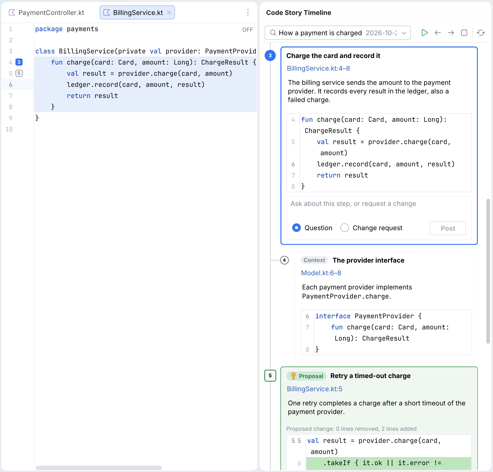
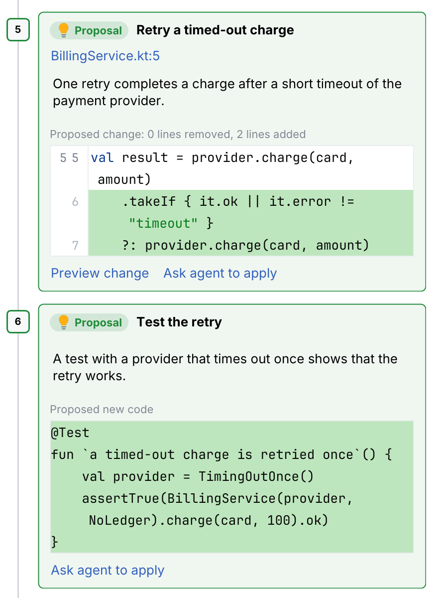

<p align="center">
  <picture>
    <source media="(prefers-color-scheme: dark)" srcset="src/main/resources/META-INF/pluginIcon_dark.svg">
    
  </picture>
</p>

<h1 align="center">Code Story</h1>

<p align="center">
  <b>Guided code walkthroughs from your AI coding agent, in your JetBrains IDE.</b>
</p>

<p align="center">
  <a href="https://github.com/Hubert-Rybak/Jetbrains-Code-Story-Plugin/actions/workflows/build.yml"></a>
  <a href="https://github.com/Hubert-Rybak/Jetbrains-Code-Story-Plugin/releases/latest"></a>
  
  <a href="LICENSE"></a>
</p>

<p align="center">
  <a href="#getting-started">Getting started</a>
  &nbsp;·&nbsp;
  <a href="docs/user-guide.md">User guide</a>
  &nbsp;·&nbsp;
  <a href="docs/agent-api.md">Agent API</a>
  &nbsp;·&nbsp;
  <a href="CHANGELOG.md">Changelog</a>
  &nbsp;·&nbsp;
  <a href="https://github.com/Hubert-Rybak/Jetbrains-Code-Story-Plugin/issues">Issues</a>
</p>

<br>

Code Story is a plugin for JetBrains IDEs, with Rider as the primary target. Ask your AI
coding agent for a story, for example
`/code-story "Explain the main change for this ticket"`. The agent writes a short story
of ordered steps and sends it to your IDE. The IDE checks each step against the code and
plays the story: each step opens its file, highlights the code that it explains and shows
a short comment in a card beside the code.

<p align="center">
  <picture>
    <source media="(prefers-color-scheme: dark)" srcset="docs/images/step-card-dark.png">
    
  </picture>
</p>

<p align="center">
  <i>The step card beside the highlighted code. The images of the step card, the tool window and the comments are illustrations of the layout.</i>
</p>

## Highlights

- **Stories for different tasks.** Ask for the main change of a ticket, how a flow works,
  how a bug can occur, or a review handoff for your branch.
- **Read at your own speed.** Go to the next or previous step from the card, the tool
  window or the keyboard. The card does not take the keyboard focus, so you can continue
  to work in the editor.
- **See the whole story in a timeline.** The timeline shows every step from top to
  bottom, with its explanation and its code, beside the editor or on a second screen.
  Click a line of code, and the editor opens it.
- **Context and proposals.** Agents add context steps with background for a step, and
  proposals of code changes that you can preview in a diff and ask the agent to apply.
- **Steps follow the code.** Steps stay on their code while you edit, and show when their
  code changed or is gone.
- **See what changed.** In a story about a change, steps show **A** for new code and **M**
  for changed code, and **Show diff** compares the file with the base commit.
- **Share stories with your branch.** A shared story is a file in `.codestory/shared/`
  that you commit with your code.
- **Ask questions in the story.** Post a question or a change request on a step, and a
  listening agent answers in the story.
- **Checked against the code.** The IDE corrects small line shifts and rejects steps whose
  code it cannot find. The agent gets each error with a fix hint.
- **Works with your agent.** Claude Code, Codex CLI, GitHub Copilot in Rider and GitHub
  Copilot CLI send stories through the IDE's MCP server, or write a story file when the
  server is off.
- **Local and private.** The plugin makes no network calls and sends no telemetry.

## Getting started

You need Rider or IntelliJ IDEA 2025.3 or newer, and one of these agents on the same
machine: Claude Code, Codex CLI, GitHub Copilot in Rider (Agent mode) or GitHub Copilot
CLI.

1. **Install the plugin.** Download `code-story-<version>.zip` from the
   [latest release](https://github.com/Hubert-Rybak/Jetbrains-Code-Story-Plugin/releases/latest).
   In the IDE, open **Settings | Plugins**, click the gear icon, choose **Install Plugin
   from Disk** and select the zip.
2. **Install the skill.** Choose **Tools | Code Story | Install Code Story skill**. The
   plugin writes the `code-story` skill to `~/.agents/skills/` and `~/.claude/skills/`,
   where every supported agent finds it.
3. **Switch on the MCP server.** Open **Settings | Tools | MCP Server**, select **Enable
   MCP Server**, confirm with **Enable** and click **Apply**.
4. **Connect your agent.** On the same page, click **Auto-Configure** next to your agent.
   If your agent is not in the list, copy the server address from **Manual Client
   Configuration** into the agent's MCP configuration. Then restart the agent.
5. **Ask for a story.** Start the agent in the folder of a project that is open in the
   IDE, and run the skill:

   ```text
   /code-story "Explain the main change for this ticket"
   ```

   In Codex, the skill command is `$code-story`.

On the first run, a notification shows steps 2 and 3. **Tools | Code Story | Check setup**
shows what is missing. To install the skill into the project, or to use Code Story
without the MCP server, see [Set up](docs/user-guide.md#set-up) in the user guide.

## Usage

### Ask for a story

Tell the agent what you want to understand. The agent uses the conversation, and reads
the code when the conversation does not cover the subject:

```text
/code-story "How does the payment flow work?"
/code-story "How can this NullReferenceException occur?"
/code-story "Prepare a review handoff for this branch"
```

A story has a type (change, exploration, bug trace or review), a title, a short summary
and 3 to 12 steps. To change a story, ask the agent.

### Read a story

The story starts at step 1. Use **Prev** and **Next** in the step card or in the
**Code Story** tool window, or use the keyboard. Each shortcut starts with
**Ctrl+Alt+Shift+Z**. Release these keys, then press the second key:

| Second key | Action |
|---|---|
| **Right** | Next Step |
| **Left** | Previous Step |
| **End** | Stop Story |
| **C** | Comment on Current Step |
| **T** | Show Story Timeline |

Numbered gutter badges go to the other steps in the file. **Play** in the tool window
continues a story at your last step.

<p align="center">
  <picture>
    <source media="(prefers-color-scheme: dark)" srcset="docs/images/tool-window-dark.png">
    
  </picture>
</p>

### Read a story in the timeline

**Open in Timeline** in the tool window shows every step of the story from top to bottom
in the **Code Story Timeline** tool window: the agent's explanation, the code of the step
with the line numbers of its file, context under the step that it explains, and proposed
changes. Click a line of code, and the editor beside the timeline opens the file at that
line and highlights the step. The timeline follows **Prev**, **Next** and your edits. See
[The timeline](docs/user-guide.md#the-timeline) in the user guide.

<p align="center">
  <picture>
    <source media="(prefers-color-scheme: dark)" srcset="docs/images/timeline-dark.png">
    
  </picture>
</p>

<p align="center">
  <picture>
    <source media="(prefers-color-scheme: dark)" srcset="docs/images/timeline-proposals-dark.png">
    
  </picture>
</p>

### Ask the agent

Type a question or a change request in the card, and click **Post** (Ctrl+Enter). A
listening agent gets it immediately, and its answer appears below your comment. For a
change request, the agent changes the code with its own tools and updates the steps. If
your agent has stopped, run `/code-story feedback`.

<p align="center">
  <picture>
    <source media="(prefers-color-scheme: dark)" srcset="docs/images/comments-dark.png">
    
  </picture>
</p>

### Share a story

Choose **Share** in the tool window. The story moves to `.codestory/shared/`, and you
commit it with your branch. When your teammates check out or pull the branch, the story
appears in their tool window with a **new** marker. **Copy as Markdown** copies a story
for a pull request description.

## Documentation

- [User guide](docs/user-guide.md): setup options, playback, change information, sharing,
  questions and change requests, feedback hooks and settings.
- [Agent API](docs/agent-api.md): the MCP tools, story validation, patch operations and
  story files.
- [Story schema](schema/story-v1.schema.json): the JSON Schema of the story format.
- [Changelog](CHANGELOG.md): the changes in each version.
- [Product specification](spec.md): the design of the plugin.

## Known limits

- **Local IDE only.** Remote development, split mode and JetBrains Client are not
  supported.
- **Not on JetBrains Marketplace yet.** Install the zip from disk. The IDE does not update
  the plugin automatically.
- **Tested in Rider and IntelliJ IDEA.** Other IntelliJ-based IDEs from 2025.3 load the
  plugin, but are not tested.
- **The MCP server is off by default.** Only you can switch it on. Without it, agents
  deliver stories as files and get no validation report.
- **One IDE per agent connection.** An agent talks to the MCP server of the IDE that it is
  configured for. When the project is not open in that IDE, the skill writes a file.
- **Listening needs an active agent.** The plugin cannot restart an agent turn that ended.
  If the agent does not listen, continue with `/code-story feedback`.
- **Text anchors.** Steps anchor to a file, a line range and the text of the first line,
  not to code symbols. After large edits, steps can be **lost** until the agent refreshes
  them.
- **Git only.** Change information needs Git and the Git plugin. Other version control
  systems are not supported.
- **Agent-written stories.** You cannot edit, rename or reorder stories or steps in the
  IDE; ask the agent. One story plays at a time in a project, and each step has one code
  range at most. The plugin never applies a proposal itself: your agent applies it, or you
  apply it in the diff viewer.
- **Writing checks for English only.** The checks are mechanical. There is no check
  against the ASD-STE100 dictionary.
- **Your own agent.** Comments go to your agent, not to the author of a shared story.
- **No CodeTour import or export** yet.

## Privacy and security

- The plugin makes no network calls and sends no telemetry.
- Code Story tools only create, read and update stories and their threads in
  `.codestory/`. They never run code or commands. Your agent makes the code changes for
  change requests, with its own tools and permission prompts.
- The IDE's MCP server accepts calls from local programs and has its own tools. Its
  confirmation dialog lists what they can do. Code Story adds only
  [its own tools](docs/agent-api.md#mcp-tools).
- Story files from Git are untrusted input. Paths must stay inside the repository:
  absolute paths, `..` and symbolic links that lead outside are rejected. Text is shown
  without HTML. Links allow only http/https and project files, and open only on click.
- Every story shows `Written by <agent> (<model>)`.
- The plugin never installs hooks and never changes the MCP server setting.

## Contributing

Report bugs and ideas in the
[issue tracker](https://github.com/Hubert-Rybak/Jetbrains-Code-Story-Plugin/issues). To
build the plugin, run the tests or make a release, see [CONTRIBUTING.md](CONTRIBUTING.md).

## License

Code Story is licensed under the [Apache License 2.0](LICENSE). See
[THIRD_PARTY_NOTICES.md](THIRD_PARTY_NOTICES.md) for third-party notices.
