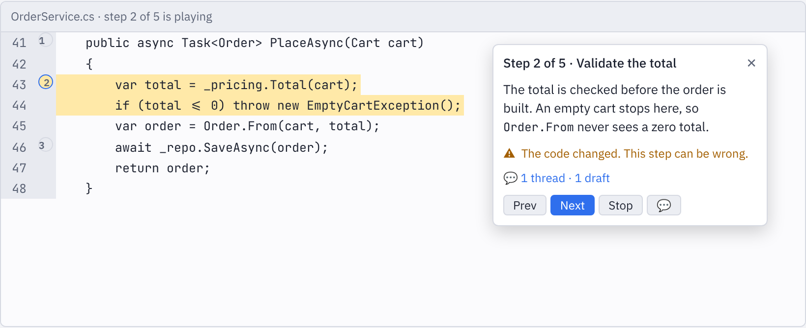
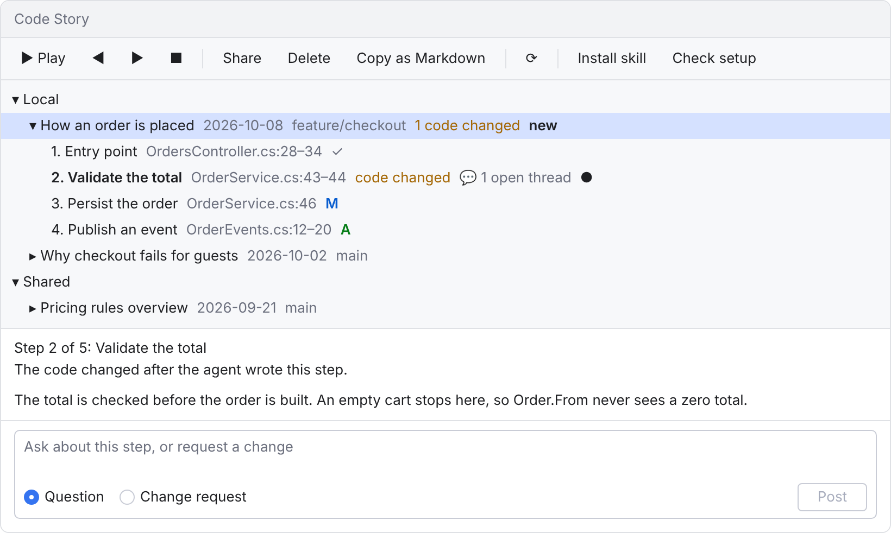
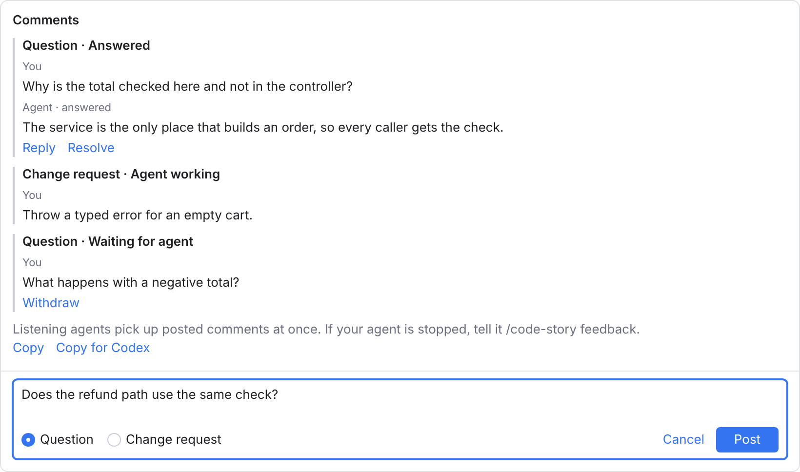

# Code Story

Code Story is a Rider plugin for guided code walkthroughs. Ask your AI coding agent
for a story, for example
`/code-story "Explain the main change for this ticket"`. The agent writes a short story
of ordered steps and sends it to your running IDE. Each step opens its file, highlights
the code that it explains and shows a floating card with a short comment. Stories stay on
the right code while you edit, travel with your branch when you share them, and carry
your questions and change requests back to the agent.

Code Story works with Claude Code, Codex CLI, GitHub Copilot in Rider and GitHub Copilot
CLI. See [CHANGELOG.md](CHANGELOG.md) for the release notes, [spec.md](spec.md) for the
product specification and [docs/v1-verification.md](docs/v1-verification.md) for the
historical v1 verification record. The current release checks are in
[docs/release-checklist.md](docs/release-checklist.md).

<p align="center">
  <picture>
    <source media="(prefers-color-scheme: dark)" srcset="docs/images/step-card-dark.png">
    
  </picture>
</p>

*The step card beside the highlighted code. The images in this README are illustrations of the layout, drawn in light and dark themes.*

- [Requirements](#requirements)
- [Install](#install)
- [Set up your agent](#set-up-your-agent)
- [Use](#use)
- [Settings](#settings)
- [Agent tools](#agent-tools)
- [Story files](#story-files)
- [Known limits](#known-limits)
- [Privacy and security](#privacy-and-security)
- [Develop](#develop)
- [Release](#release)

## Requirements

- Rider 2026.1 or newer, running on your machine (minimum build RD-261.22158.335).
  Only Rider is supported. The current automated validation target is pinned to
  Rider 2026.2.3.1 (RD-262.10968.170); newer versions are not implicitly verified.
- An AI coding agent on the same machine: Claude Code, Codex CLI, GitHub Copilot in Rider
  (agent mode) or GitHub Copilot CLI.
- Optional: the bundled MCP Server plugin, so that agents send stories directly and get
  validation reports. Without it, agents write story files instead.
- Optional: the bundled Git plugin, for branch and commit metadata and change information.
- Optional: Python 3, for the [feedback hook snippets](#optional-feedback-hooks).

## Install

1. Download `code-story-1.0.0.zip` from
   [GitHub Releases](https://github.com/Hubert-Rybak/Jetbrains-Code-Story-Plugin/releases).
   Do not unpack it.
2. In the IDE, open **Settings | Plugins**, click the gear icon and choose
   **Install Plugin from Disk**. Select the zip, and restart the IDE if it asks.
3. Open **View | Tool Windows | Code Story**. The window starts on the right; use the
   IDE's normal tool window controls to move it.

To update, install a newer zip the same way. The plugin is not on JetBrains Marketplace
yet, so the IDE does not update it by itself. After an update, the plugin offers to update
the installed skills. To remove the plugin, uninstall **Code Story** in
**Settings | Plugins**; your story files stay in `.codestory/`.

## Set up your agent

Your agent needs two things: the `code-story` skill, and a connection to the IDE's MCP
server. On the first run, the plugin shows one notification with both steps.

### 1. Install the skill

Choose **Tools | Code Story | Install Code Story skill** (also in the Code Story toolbar).
It writes the same skill to `~/.agents/skills/code-story/` and
`~/.claude/skills/code-story/`, so that every supported agent finds it. To install the
skill into the project instead, select **Install the Code Story skill in the current
project** in **Settings | Tools | Code Story** and run the action again: the copies then go
to `.agents/skills/code-story/` and `.claude/skills/code-story/` at the Git repository
root (the project folder without Git). After a plugin update, the plugin offers to update
older copies. You can also copy [`skills/code-story`](skills/code-story) into these
folders by hand.

### 2. Switch on the MCP server

Open **Settings | Tools | MCP Server**, select **Enable MCP Server**, confirm with
**Enable**, and click **Apply**. The confirmation lists the access that local programs get
to your open projects. Code Story never changes this setting itself.

**Auto-Configure**, in the **Clients Auto-Configuration** list on the same page, writes
the configuration of a detected agent for you. The available clients depend on your
installed Rider version. Restart the agent after you configure it. For an agent that
is not in the list, use **Manual Client Configuration**: **Copy SSE Config**,
**Copy Stdio Config**, or **Copy HTTP Stream Config**. Use the copied address rather
than a hard-coded port.

### 3. Connect your agent

| Agent | Skill folder | MCP connection | Ask for a story |
|---|---|---|---|
| [Claude Code](#claude-code) | `~/.claude/skills/` | Auto-Configure | `/code-story "<request>"` |
| [Codex CLI](#codex-cli) | `~/.agents/skills/` | Auto-Configure or `~/.codex/config.toml` | `$code-story "<request>"` |
| [GitHub Copilot in Rider](#github-copilot-in-rider) | `~/.agents/skills/` | `mcp.json` of Copilot Chat | `/code-story "<request>"` in Agent mode |
| [GitHub Copilot CLI](#github-copilot-cli) | `~/.agents/skills/` | Auto-Configure or `/mcp add` | `/code-story "<request>"` |

Start the agent in the folder of a project that is open in the IDE.

#### Claude Code

1. Claude Code reads the skill from `~/.claude/skills/code-story/`. A running session
   picks up new skills; if the `~/.claude/skills/` folder did not exist when the session
   started, run `/reload-skills`.
2. Click **Auto-Configure** next to **Claude Code**, then restart Claude Code. `/mcp`
   shows the IDE's server.
3. Type `/code-story "Explain the main change for this ticket"`.

#### Codex CLI

1. Codex reads the skill from `~/.agents/skills/code-story/` and finds new skills by
   itself. If `$code-story` does not appear in `/skills`, restart Codex.
2. If the list has **Codex**, click **Auto-Configure**. Otherwise, add the server to
   `~/.codex/config.toml` yourself. Codex connects to streamable HTTP and stdio servers,
   not to SSE servers. Use the URL from **Copy HTTP Stream Config**:

   ```toml
   [mcp_servers.jetbrains]
   url = "<the URL from Copy HTTP Stream Config>"
   ```

   To use stdio instead, put the `command`, `args` and `env` values from
   **Copy Stdio Config** into the same table. Restart Codex; `/mcp` lists the server.
3. Type `$code-story "Explain the main change for this ticket"`.

#### GitHub Copilot in Rider

1. Copilot reads the skill from `~/.agents/skills/code-story/`. If Copilot does not use
   it, check that agent skills are on in **Settings | Tools | GitHub Copilot | Chat |
   Agent**.
2. Open Copilot Chat in **Agent** mode, click the tools icon, and click **Add MCP Tools**.
   In `mcp.json`, add the IDE's server with the URL from **Copy HTTP Stream Config** or
   **Copy SSE Config**:

   ```json
   {
     "servers": {
       "rider": { "url": "<the URL from the copied configuration>" }
     }
   }
   ```

   On Business and Enterprise plans, an administrator must allow the "MCP servers in
   Copilot" policy.
3. In Agent mode, type `/code-story "Explain the main change for this ticket"`. Copilot
   loads the skill when the request matches the skill's description.

#### GitHub Copilot CLI

1. Copilot CLI reads the skill from `~/.agents/skills/code-story/`. In a running session,
   run `/skills reload`; `/skills info code-story` shows where Copilot found it.
2. If the list has **GitHub Copilot CLI**, click **Auto-Configure**. Otherwise, run
   `/mcp add`, choose the HTTP type with the URL from **Copy HTTP Stream Config** (or the
   SSE type with the URL from **Copy SSE Config**), and allow all tools. The CLI saves the
   server in `~/.copilot/mcp-config.json`, and `/mcp show <name>` lists its tools.
3. Type `/code-story "Explain the main change for this ticket"`.

### Check setup

**Tools | Code Story | Check setup** (also in the Code Story toolbar) shows whether the
MCP server is on, the Code Story tools that it registered, the bundled skill version, and
every installed skill copy with its version. **Copy feedback hooks** in the same dialog
copies the [optional feedback hooks](#optional-feedback-hooks). When the MCP server is
off, a notification links to its settings page.

### Without the MCP server

When the Code Story tools are missing, or the target project is not open in the IDE, the
skill writes a complete story file to `.codestory/local/`, using a temporary file and
then a rename. The plugin watches `.codestory/` only, including files dropped before the
project opens. It checks new and changed local stories against the same location rules
and unsaved editor text as MCP. A file drop has no report channel to the agent: errors
appear in the tool window and clear when the file is fixed or removed. Valid drops play
in every IDE that has the project open. MCP-delivered stories carry `"delivery": "mcp"`,
so other IDEs list them without auto-playing them.

## Use

### Ask for a story

Open the project in the IDE, and ask your agent:

```text
/code-story "Explain the main change for this ticket"
/code-story "How does the payment flow work?"
/code-story "How can this NullReferenceException occur?"
/code-story "Prepare a review handoff for this branch"
```

Use `$code-story` in Codex. The agent uses the conversation, and explores the code when
the conversation does not cover the subject. It writes a story with a type (change,
exploration, bug trace or review), a title, a short summary and 3 to 12 steps (15 at
most). Each step explains one idea about a small code range, in short sentences of simple
English. Text-only steps can introduce or close the story.

The agent first calls `code_story_guide` for the writing rules, format and example
bundled with the installed plugin version. It calls `code_story_show` with the story and
the `projectPath` of the project. The IDE checks the story against the project files. A
valid story is saved in `.codestory/local/` at the Git repository root (the project
folder when there is no Git) and appears in the tool window. It starts at step 1 and
brings the IDE to the front (see [Settings](#settings)). `.codestory/local/` has its own
`.gitignore`, so local stories stay out of Git.

A story with errors is not saved: the tool returns each error with the step number, a
code, a message and a fix hint, so the agent can correct the story and send it again.
Each step location carries `anchorText`, the exact text of its first line. The IDE
compares it with the line that it shows, including unsaved edits; indentation, trailing
spaces and line endings do not matter. When the text is within 20 lines of the given
line, the IDE moves the range and the report lists a correction (for example
`Step 4: lines 120–131 changed to 123–134.`). When it cannot find the text, it rejects
the story. The plugin stores the code of each range in the story.

The report also includes writing warnings and warnings for ranges longer than 30 lines.
They never block a story and appear only in the agent report. The guide asks the agent
to fix them once and replace the story with its returned ID. Mechanical checks cover
title, sentence and comment lengths, list structure, semicolons and contractions. Code
names count as one word. Optional passive voice and -ing hints are off by default.

To revise a story, ask your agent. It finds the story with `code_story_list` and
`code_story_get`, and replaces it with `code_story_show(story, storyId)`; the same file
and creation metadata are kept. A playing story reloads at the same step number, or the
last step if the revision is shorter.

### Read a story

The current step shows a floating card beside the highlighted code, with "Step N of M",
the step title, the comment and **Prev**, **Next** and **Stop**; the tool-window toolbar
has the same buttons. On the last step, **Next** becomes **Finish**. The card leaves the
target code and the caret visible and does not take keyboard focus, so you can type,
select code and click in the editor while the story plays. When the editor has no room
for the card, the same card appears in the tool window. Text-only steps show their
comment in the details pane and leave the editor as it is. Steps open in the preview tab
when the IDE uses preview tabs.

<p align="center">
  <picture>
    <source media="(prefers-color-scheme: dark)" srcset="docs/images/tool-window-dark.png">
    
  </picture>
</p>

Numbered gutter badges jump to other steps in the same file. Closing the card keeps your
place and the highlighted code; click the current badge or step to reopen it. Scrolling
and switching tabs hide and restore the card without moving your caret or scrolling
back. **Stop** and **Finish** remove the card, the highlight and the badges.

The **Code Story** tool window lists stories newest first, with title, date, branch and
type icon, and their steps with number, title, file and lines. ✓ marks show the steps
that you visited in this IDE session. Selecting a story shows its summary, original
request, "Written by <agent> (<model>)", creation date, branch and commit. A note
appears when the current branch differs from the branch where the story was created.
Without Git, the metadata is shown as unavailable.

**Play** resumes the selected story at your last step. Right-click the story and choose
**Restart** to start at step 1. One story plays at a time in a project. Reading positions
stay in your IDE workspace and never go into story files.

The default shortcuts start with **Ctrl+Alt+Shift+Z**; release those keys, then press
**Right** for **Next Step**, **Left** for **Previous Step**, **End** for **Stop Story**,
or **C** for **Comment on Current Step**. Change them in **Settings | Keymap** by
searching for the action name.

Comments support inline code, bold, bullet lists and links to http/https URLs or
repository files (`src/App.kt#L2-L5`). Links open only when clicked. Headings, images,
tables and HTML stay plain text.

### Stories about a change

A story about a change can set `baseRef`: the commit before the change, or `HEAD` for
uncommitted work. The plugin saves the full SHA of that commit, so the base stays the
same after the work is committed. Each step then shows **A** in the tree when all of its
lines are new since the base, or **M** when some of them changed; steps without changes
show no badge. **Show diff**, in the step details and the context menu, opens the IDE
diff viewer: the file at the base commit against the current file, scrolled to the
step's lines. A renamed file is compared with its old path. A `baseRef` that Git does not
know gives an `unknown-base-ref` warning in the report, and the story then shows no
change information, like a story without a base. Without the Git plugin, change
information is off.

### When the code changes

While a story plays, live range markers follow your edits, so the card and the highlight
stay on the right code. When a story is listed or played, the plugin finds the code of
each step again. A step is **ok**; **moved** (the lines are updated); **code changed**
(the range has other code than the step explains: the tree shows a badge and the card a
note); or **lost** (the code is gone: the step plays at its stored lines, and the card
warns "The code changed. This step can be wrong."). The story row shows the number of
lost and changed steps, and `code_story_list` reports the status. Moved lines are saved
in local stories only; shared story files never change, and their corrections stay in
memory. To bring stale steps up to date, use **Request refresh**
([below](#questions-and-change-requests)).

### Share and manage stories

The tree groups stories under **Local** and **Shared**. **Share** moves a story to
`.codestory/shared/` so you can commit it with the branch; **Unshare** moves it back. Its
ID and creation metadata stay the same. **Delete** asks for confirmation before removing
the file. These actions are in the toolbar and context menu. **Copy as Markdown**, in
both menus, copies the title, summary, and steps with repository-relative line links and
comments for a pull request description. Reader threads are not included.

Shared stories that arrive through checkout or pull appear automatically with a **new**
marker. They do not start playback. Playing one clears the marker in your IDE workspace,
without changing the shared file.

With several Git repositories mapped in one project, the tree groups by repository and
each repository has its own `.codestory/`. A story must stay inside one repository.

### Questions and change requests

Ask your agent about a story, or ask it for a code change, without leaving the IDE.

<p align="center">
  <picture>
    <source media="(prefers-color-scheme: dark)" srcset="docs/images/comments-dark.png">
    
  </picture>
</p>

1. **Write comments.** The card’s **💬** button opens a small comment input under the
   step text. In the tool window, select a step or a story and click **Comment on step**
   or **Comment on story** in the details pane (or **Comment** in the context menu).
   **Ctrl+Alt+Shift+Z**, then **C**, comments on the current step. For each comment or
   reply, choose **Question** (the default) or **Change request**. **Save Draft**
   (Ctrl+Enter) keeps the comment as a draft in your IDE workspace; drafts never go into
   the story file. You can edit or delete a draft, and the story row shows how many
   drafts it has.
2. **Submit the round.** **Submit Round (N)**, in the details pane and the toolbar,
   writes all drafts of the story into the story file as one numbered round. Until an
   agent fetches a comment, it shows "Waiting for agent", and you can **Withdraw** it back
   to your drafts.
3. **Your listening agent picks it up.** The bundled skill calls `code_story_listen`
   after showing a story and after each reply, so Submit Round needs no extra chat
   prompt. A fetched comment shows "Agent working". If your agent has stopped, tell it
   `/code-story feedback` (`$code-story feedback` in Codex); the notification and details
   pane have buttons to copy the command.
4. **Read the answers.** A notification tells you that answers arrived, and **Open**
   shows the story. The answers appear under your comments, and a story that is playing
   keeps its step. Step rows show open-thread counts and a dot for unread answers;
   opening the threads clears the dot. The collapsed **💬 N threads · N drafts** line in
   the card expands the threads inside the card.
5. **Continue or close.** **Reply** in a thread adds a draft that opens the thread again
   in the next round. **Resolve** closes a thread; resolved threads are hidden until you
   select **Show resolved**.

Listening is enabled by default. Install the current bundled skill with **Tools | Code
Story | Install Code Story skill** to enable this workflow. Disable **Let connected
agents listen for submitted feedback automatically** in **Settings | Tools | Code Story**
for manual feedback only. You can also cancel the waiting agent or tell it to stop.
The tool waits up to 25 seconds per call; the skill reconnects after timeout and after
answering a round. Drafts do not wake it. Listening requires an active agent session;
it cannot restart an agent that ended its turn. Copilot in Rider needs no hook when its
client supports active waiting calls. Optional hooks only remind sessions that are not
listening.

The listening tool uses the same fetch path as `code_story_feedback`, oldest round first.
The agent answers each comment with `code_story_reply`: `answered` for questions, `done` for change
or refresh requests, or `declined` with a reason.

- **Questions:** the agent answers from the story, the thread and the code, and never
  changes code. When a question shows that the story was unclear, it improves the step
  text or inserts steps with `code_story_patch`. The plugin then adds a **Story changes**
  line to the reply.
- **Change requests:** the agent applies the change with its normal tools and permission
  prompts, updates every affected step, and replies `done` with a short summary and the
  changed files, which appear with the reply. The plugin rejects `done` with a list of
  steps that still need review: every step in **code changed** or **lost** status must
  be updated, replaced or confirmed after the round was fetched, and a later code edit
  requires another review.
- **Request refresh**, in the story or step context menu, adds a refresh item to the
  story’s latest unfetched round (or starts a new round). The listening agent picks it
  up automatically; use `/code-story feedback` if the agent has stopped. With no pending
  comments, feedback mode still finds and refreshes **code changed** and **lost** steps.

Threads are part of the story file, so they travel with a shared story, and a comment on
a shared story changes that file. Unread state stays in your IDE workspace across
restarts and never changes a story file. When an agent revises a story, each thread stays
on its step (by step ID); threads of removed steps move to the story with the note “step
removed”. Agent answers follow the writing rules with larger limits (1 to 5 sentences, or
a lead sentence and up to 6 list items, 100 words at most); the checks give warnings only.
A reply to a comment that is already answered gets `already-answered`, so two agent
sessions never answer the same comment twice.

### Optional feedback hooks

The plugin maintains `.codestory/local/pending-feedback.json`, a small local index of
pending story IDs, folders, counts and rounds. It includes submitted and fetched
feedback, omits drafts, comment text and code, and clears entries as feedback is answered,
withdrawn or deleted. The IDE refreshes it on project open and story file changes.
**Check setup → Copy feedback hooks** copies the helper and all configurations below.
The plugin never installs hooks. The snippets need Python 3; replace `python3` with your
Python executable if needed. Merge the configuration with existing hooks. The reminders
ask the agent to mention pending feedback and process it when you ask or agree.
They do not push feedback to the agent or start feedback mode.

Save this helper as `~/.codestory/feedback-hook.py` (create the directory yourself):

```python
import json
import os
from pathlib import Path
import sys

try:
    event = json.load(sys.stdin)
    if not isinstance(event, dict):
        raise ValueError("Invalid hook input")
    cwd = Path(event.get("cwd") or os.getcwd()).resolve()
    ancestors = [cwd, *cwd.parents]
    root = next((p for p in ancestors if (p / ".git").exists()), None)
    if root is None:
        root = next((p for p in ancestors if (p / ".codestory").is_dir()), cwd)
    index = root / ".codestory/local/pending-feedback.json"
    data = json.loads(index.read_text(encoding="utf-8"))
    if not isinstance(data, dict):
        raise ValueError("Invalid feedback index")
    if data.get("schemaVersion") != 1 or data.get("pendingComments", 0) <= 0:
        raise ValueError("No pending feedback")
    context = (
        "Code Story feedback is pending in this repository. Mention it to the "
        "developer and process it with the code-story feedback skill when they "
        "ask or agree. Fetch current feedback from the IDE before making changes."
    )
    if sys.argv[1] == "copilot":
        print(json.dumps({"additionalContext": context}))
    else:
        print(json.dumps({"hookSpecificOutput": {
            "hookEventName": event["hook_event_name"],
            "additionalContext": context
        }}))
except (OSError, ValueError, KeyError, TypeError, IndexError):
    print("{}")
```

Claude Code: merge into `~/.claude/settings.json` (or `.claude/settings.json` in the
project). Reminders run at session start and on each prompt:

```json
{
  "hooks": {
    "SessionStart": [{"hooks": [{"type": "command", "command": "python3 \"$HOME/.codestory/feedback-hook.py\" claude"}]}],
    "UserPromptSubmit": [{"hooks": [{"type": "command", "command": "python3 \"$HOME/.codestory/feedback-hook.py\" claude"}]}]
  }
}
```

Codex: merge into `~/.codex/hooks.json` (or `.codex/hooks.json` in the project), using
a Codex version with lifecycle hook support. Reminders run at session start and on
each prompt. Review/enable the hook in Codex if your version requires that:

```json
{
  "hooks": {
    "SessionStart": [{"hooks": [{"type": "command", "command": "python3 \"$HOME/.codestory/feedback-hook.py\" codex"}]}],
    "UserPromptSubmit": [{"hooks": [{"type": "command", "command": "python3 \"$HOME/.codestory/feedback-hook.py\" codex"}]}]
  }
}
```

Copilot CLI: merge into `.github/hooks/code-story.json` in the project. The reminder
runs at session start. The Rider Copilot plugin has no suitable hook:

```json
{
  "version": 1,
  "hooks": {
    "sessionStart": [{
      "type": "command",
      "bash": "python3 \"$HOME/.codestory/feedback-hook.py\" copilot",
      "powershell": "python \"$HOME/.codestory/feedback-hook.py\" copilot",
      "timeoutSec": 5
    }]
  }
}
```

Agent references: [Claude Code hooks](https://code.claude.com/docs/en/hooks),
[Codex hooks](https://developers.openai.com/codex/hooks),
[Copilot CLI hooks](https://docs.github.com/en/copilot/reference/hooks-configuration).

## Settings

**Settings | Tools | Code Story**:

| Setting | Default | What it does |
|---|---|---|
| Bring the IDE to the front on a new story | On | A new story brings the IDE window to the front. When it is off, the story still opens and plays. |
| Include passive voice and -ing hints in agent reports | Off | Adds these optional writing hints to the agent's reports. Code text such as "string" or "mapping" can give false hints. |
| Install the Code Story skill in the current project instead of the user folder | Off | **Install Code Story skill** writes to `.agents/skills/` and `.claude/skills/` at the repository root instead of your home folder. |
| Let connected agents listen for submitted feedback automatically | On | Waiting agents pick up Submit Round. Turning this off ends waiting calls; manual feedback remains available. |
| Highlight color | Use theme default | The background of the current step's range. Clear **Use theme default** to choose a color; transparency is supported. |

Other places:

- **Settings | Keymap**: **Next Step**, **Previous Step**, **Stop Story** and
  **Comment on Current Step**.
- **Settings | Tools | MCP Server**: the IDE's MCP server (see
  [Switch on the MCP server](#2-switch-on-the-mcp-server)).
- **Settings | Appearance & Behavior | Notifications**: the **Code Story** notification
  group.

## Agent tools

The plugin adds eight tools to the IDE's MCP server. Each call needs the `projectPath` of
an open project, and each result names the agent's next call. `repositoryPath`, the
absolute repository root, selects the repository when paths or story IDs match several
repositories, or for a text-only story.

| Tool | What it does |
|---|---|
| `code_story_guide` | Returns the writing guide, the story format and an example for the installed version. |
| `code_story_show` | Checks a story; when it has no errors, saves and plays it. With `storyId`, replaces that story in its local or shared file. Returns errors, corrections and warnings. |
| `code_story_list` | Lists local and shared stories: ID, title, type, date, branch, repository path, folder, status (`ok`, `moved`, `code-changed` or `lost`, with step counts) and `pendingComments`. |
| `code_story_get` | Returns the full saved story with its comment threads. |
| `code_story_patch` | Edits a story with ordered `update`, `insert`, `remove` and `confirm` operations. |
| `code_story_listen` | Waits for submitted rounds by default. Returns feedback, a timeout to reconnect, or stopped when listening is disabled. |
| `code_story_feedback` | Returns the reader's comments that wait for an agent, oldest round first, and the stale steps. |
| `code_story_reply` | Saves one reply per comment: `answered`, `done` with `changedFiles` (`[]` when no code files changed), or `declined` with a reason. |

`code_story_patch` operations: `update` (stepId; title, comment or location),
`insert` (afterStepId and a complete step), `remove` (stepId) and `confirm` (stepId).
Confirm makes the current code the step’s new reference and returns its status to **ok**;
the agent must read the current code first and check that the explanation still fits. A
missing file or range needs a new location or removal. Locations include anchor text; an
explicit null makes a step text-only. A patch checks the whole structure and validates
edited steps like `code_story_show`; untouched steps keep their code references,
including stale steps. Any error saves nothing. Threads and creation metadata stay
intact. Replies show a **Story changes** line for the net story edits made while the
comment was received.

## Story files

- Stories are in `.codestory/local/` (ignored by Git) and `.codestory/shared/` (committed
  with the branch) at the Git repository root, or in the project folder without Git.
- Files are named `<yyyy-MM-dd>-<slug>.story.json`; the name without `.story.json` is the
  story ID. The plugin adds a number suffix when a name already exists.
- The format is described by the JSON Schema in
  [`schema/story-v1.schema.json`](schema/story-v1.schema.json) (`schemaVersion` 1).
  Paths are relative to the repository root; line numbers are 1-based and inclusive.
- A story has at most 15 steps, and a file at most 256 KB.
- The plugin records the creation time and Git state, and assigns stable IDs to steps
  that have none.
- `.codestory/local/pending-feedback.json` is the local index for the
  [feedback hooks](#optional-feedback-hooks).
- Reading positions, visited marks, comment drafts and unread markers stay in IDE
  workspace storage, never in story files.

## Known limits

- **Local IDE only.** Remote development, split mode and JetBrains Client are not
  supported.
- **Install from disk.** The plugin is not on JetBrains Marketplace yet, and the IDE does
  not update it automatically.
- **Rider only.** The compilation baseline is Rider 2026.1. Tests and binary verification
  target the single current Rider version pinned by `riderVersion` in `gradle.properties`.
  There is no IDEA, older-version or EAP compatibility matrix.
- **The MCP server is off by default.** Only you can switch it on. Without it, agents
  deliver stories as files and get no validation report.
- **One IDE per agent connection.** An agent talks to the MCP server of the IDE that it
  is configured for. When the project is not open in that IDE, the skill writes a file.
- **Listening needs an active agent.** Submit Round is picked up automatically while
  the agent keeps `code_story_listen` active. The plugin cannot restart an ended agent
  turn. If the client disconnects or cannot maintain waiting calls, resume with
  `/code-story feedback`. Hooks are optional reminders, not a requirement for listening.
- **Text anchors.** Steps anchor to a file, a line range and the text of the first line,
  not to code symbols. After large edits, steps can be **lost** until the agent
  refreshes them.
- **Git only.** Change information needs Git and the Git plugin; other version control
  systems are not supported.
- **Agent-written stories.** You cannot edit, rename or reorder stories or steps in the
  IDE; ask the agent. One story plays at a time in a project, and each step has one code
  range at most.
- **Writing checks.** The checks are mechanical and for English only. There is no check
  against the ASD-STE100 dictionary.
- **Your own agent.** Comments go to your agent, not to the author of a shared story.
- **No CodeTour import or export** yet; it is planned for v1.1.

## Privacy and security

- The plugin makes no network calls and sends no telemetry.
- Code Story tools only create, read and update stories and their threads in
  `.codestory/`. They never run code or commands. Code changes for change requests are
  made by your agent, with its own tools and permission prompts.
- The IDE's MCP server accepts calls from local programs and has its own tools. Its
  confirmation dialog lists what they can do; Code Story adds only the tools above.
- Story files from Git are untrusted input. Paths must stay inside the repository:
  absolute paths, `..` and symbolic links that lead outside are rejected. Text is shown
  without HTML; links allow only http/https and project files, and open only on click.
- Every story shows "Written by <agent> (<model>)".
- The plugin never installs hooks and never changes the MCP server setting.

## Develop

This single-module Kotlin project is based on the
[official IntelliJ Platform Plugin Template](https://github.com/JetBrains/intellij-platform-plugin-template/tree/b7b700870b23e1323353a0350a1acd9cc6d2b225).
It compiles against Rider 2026.1 (RD-261.22158.335), using a Java 21 toolchain,
Java 21 bytecode and Kotlin language/API 2.3. The Kotlin compiler plugin remains
2.4.20; the plugin does not bundle its own Kotlin standard library or serialization
library. The SDK's bundled JBR is not the compilation target: the baseline's
relevant platform and MCP classes use Java 21 bytecode even though its JBR is 25.

`riderBaselineVersion` and `riderBaselineBuild` in `gradle.properties` pin the
compilation SDK and descriptor minimum. Independently, `riderVersion` and `riderBuild`
pin the current test and verification target: Rider 2026.2.3.1 (RD-262.10968.170).
Update both current-target properties together when validating a newer stable release;
do not raise the compilation baseline just to update the test runtime.

Use JDK 25 to run Gradle and the current Rider tests/verifier, with a UTF-8 locale
(some test names contain typographic apostrophes). The existing Foojay toolchain
resolver provisions the Java 21 compiler if it is missing. The Gradle wrapper is
9.8.0 and the IntelliJ Platform Gradle Plugin is 2.19.0. Import the repository as a
Gradle project, or run:

```sh
# Fast, stdlib-only policy contracts (no IDE download or JVM build).
python3 .github/scripts/test_rider_target.py
# Full suite on current Rider, ZIP build, structure check and single binary verifier.
./gradlew check buildPlugin verifyPluginStructure verifyPlugin
# Full core and IDE suite on the pinned current Rider only.
./gradlew testCurrentRider
# File-drop and setup smoke checks on current Rider with MCP Server disabled.
./gradlew testWithoutMcp
# Use the pinned current Rider installation in a separate development sandbox.
./gradlew runLocalIde -PlocalIdePath="/path/to/Rider.app"
```

The installable zip is in `build/distributions/`. `check` runs the complete,
unfiltered test source set through `testCurrentRider`: the story-core unit tests
(plain JUnit, no IDE fixture) and the IDE-level tests (IntelliJ Platform test
framework). Both run in the current Rider environment on Java 25. The default
baseline `test` execution is disabled to avoid repeating the suite on an older IDE;
invoking `test` still depends on `testCurrentRider`, so it is not a silent no-op.
Each custom test task resolves its own current-SDK classpath and uses Rider's bundled
JBR 25 through `TestIdeTask`'s runtime resolver, not a manually selected Temurin launcher
or the baseline test classpath. The Platform test framework is pinned to the published
stable 262.10968.136 artifact: Rider's exact build 262.10968.170 has no matching
framework artifact, and the default closest-version constraint can select a snapshot.
This pin is a candidate for real runtime validation, not proof that the suites pass.
`RiderRuntimeTest` checks the actual RD build and Java version in both test scenarios
against `codeStory.expectedRiderBuild`. Real Gradle results, including test counts and
the resolved runtime classpath, must be checked before claiming compatibility with an
updated target.

IDE-level tests call `code_story_show` the way the IDE's MCP server does and check
the report, the saved files and the tool window.
They also cover guide/list/get, replacement in local and shared folders, writing
reports, auto-play, playback controls, resume/restart, card dismissal,
gutter navigation, presentation cleanup and the absence of code-line inlays.
Anchoring tests edit fixture documents and check corrections, step statuses, live
markers during playback and the rewrite of local (never shared) stories. Change
information tests build a fixture Git history and check the A/M badges, the saved
base commit, **Show diff** and the unknown-base warning.
File-drop tests create and replace real files and check playback, visible problems,
corrections and delivery markers. `check` also runs these tests in a separate IDE
sandbox with MCP Server disabled, alongside the runtime-proof test. Skill tests install
and update both agent copies in temporary user and project folders; setup tests cover
status and first-run guidance.
Management tests cover share/unshare, deletion confirmation, shared arrivals without
playback, repository grouping and separate reader state for duplicate story IDs.
Core tests also cover Markdown export, including text-only steps and escaped paths.
Feedback tests cover listening, timeout, cancellation, settings and repository scope,
submit rounds in the fixture, call `code_story_feedback` and
`code_story_reply`, and check thread states, withdraw, "already answered", thread
preservation on revision, drafts in workspace storage and the details pane; core tests
cover the thread state machine, the thread format and the answer checks.

The story core (package `io.github.hubertrybak.codestory.core`) has no IDE
dependencies: the story model, the validation rules, the anchor policy, the file
format and the story folder. The plugin compiles against the bundled MCP Server
plugin and uses the kotlinx.serialization library that ships with the IDE; it does
not bundle its own copy.

```sh
# One binary-verification target: the same pinned current Rider as the test runtime.
./gradlew verifyPlugin
# Reuse the pinned current Rider installation for tests, runLocalIde and verification.
./gradlew verifyPlugin -PlocalIdePath="/path/to/Rider.app"
# Reuse both downloaded SDKs without changing either pinned target.
./gradlew check buildPlugin verifyPluginStructure verifyPlugin \
  -PlocalRiderBaselinePath="/path/to/Rider-2026.1" \
  -PlocalIdePath="/path/to/Rider-2026.2.3.1"
```

`localIdePath` supplies the current test, `runLocalIde` and verification distribution;
`localRiderBaselinePath` supplies the compilation SDK only. Each override validates
`product-info.json`: it must be a stable RD product with the exact version and build
from its corresponding properties. An IDEA installation, an arbitrary older Rider,
or an EAP is rejected. On macOS, the IDE bundle path is also accepted. Without
overrides, Gradle resolves both pinned distributions. `./gradlew runIde` launches
the baseline Rider sandbox for development; it is not a release test gate.

Build DSL references: JetBrains' [testing extension](https://plugins.jetbrains.com/docs/intellij/tools-intellij-platform-gradle-plugin-testing-extension.html),
[verification extension](https://plugins.jetbrains.com/docs/intellij/tools-intellij-platform-gradle-plugin-extension.html#pluginverification),
and the tagged 2.19.0 sources for [custom testing configurations](https://github.com/JetBrains/intellij-platform-gradle-plugin/blob/2.19.0/src/main/kotlin/org/jetbrains/intellij/platform/gradle/extensions/IntelliJPlatformTestingExtension.kt)
and [test classpath setup](https://github.com/JetBrains/intellij-platform-gradle-plugin/blob/2.19.0/src/main/kotlin/org/jetbrains/intellij/platform/gradle/tasks/TestIdeTask.kt).

## Release

CI has only `build` and `release` jobs. The build job first checks the Python policy
contracts, then runs `./gradlew check buildPlugin verifyPluginStructure verifyPlugin`
on Java 25. All core and IDE tests run on the pinned current Rider, plus the current
Rider file-drop smoke suite with MCP disabled. One Plugin Verifier target checks the
exact ZIP from `buildPlugin` against that same current Rider. No matrix, separate
verifier build or EAP resolution is used. The distribution artifact is retained for
14 days; test and verifier reports are retained for 7 days.

1. Set `version` in `gradle.properties` and in
   [`skills/code-story/version.txt`](skills/code-story/version.txt).
2. Add an entry for the version, with the release date, to [CHANGELOG.md](CHANGELOG.md).
3. Complete the [current manual checklist](docs/release-checklist.md) on the pinned
   current Rider. The [v1 verification record](docs/v1-verification.md) preserves
   historical results; it does not prove the current Rider migration is validated.
4. Push a matching tag, for example `v1.0.0`.

The tag build fails when the tag does not match `version` or when CHANGELOG.md has no
entry for the version. After the verified build job passes, the tag-only release job
publishes that build's uploaded ZIP to GitHub Releases, with the CHANGELOG entry above
the generated notes. Release publication uses the workflow's `GITHUB_TOKEN`; no
Marketplace credentials are needed. CI is currently billing-blocked; a policy-only
pass or a blocked workflow is not a successful JVM build or release verification.

Licensed under [Apache-2.0](LICENSE). See [third-party notices](THIRD_PARTY_NOTICES.md).
